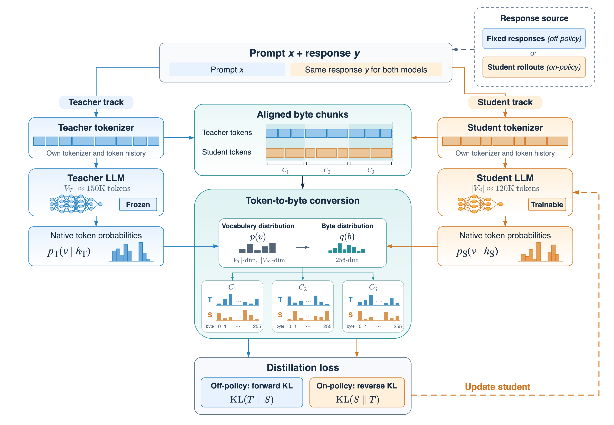

# ByteDistill

**Cross-Tokenizer Distillation via Chunk-wise Byte-Level Distribution Alignment**

NeurIPS 2026

Yang Chen · Xianqi Yu · Shaowei Yao · Fuyu Lv · Dan Ou · Haihong Tang

ByteDistill distills knowledge between language models with different tokenizers. It groups overlapping token spans into shared text chunks, converts each model's native token probabilities into distributions over the same 256 byte values, and compares those distributions with the Byte-Level Distribution Alignment (BLDA) loss. Both models retain their own tokenizers and token histories.



## Release status

Coming soon.

## Documentation

- [Method overview](docs/method.md): chunk alignment, native token histories, and training objectives.
- [Data notes](docs/data.md): the HighMATH split and pending reproducibility artifacts.
- [Contributing](CONTRIBUTING.md): questions, documentation improvements, and future code contributions.

```text
ByteDistill/
├── README.md
├── CITATION.cff
├── LICENSE
├── CONTRIBUTING.md
├── .github/                 # Issue and pull-request templates
├── assets/
│   └── training-pipeline.png
├── docs/
│   ├── method.md
│   └── data.md
├── src/                     # Implementation — pending release
├── configs/                 # Experiment configurations — pending release
├── scripts/                 # Data preparation and training — pending release
└── evaluation/              # Evaluation tools — pending release
```

## Citation

```bibtex
@inproceedings{chen2026bytedistill,
  title     = {{ByteDistill}: Cross-Tokenizer Distillation via Chunk-wise Byte-Level Distribution Alignment},
  author    = {Chen, Yang and Yu, Xianqi and Yao, Shaowei and Lv, Fuyu and Ou, Dan and Tang, Haihong},
  booktitle = {Advances in Neural Information Processing Systems},
  year      = {2026}
}
```

## License

This repository is licensed under [Apache License 2.0](LICENSE). Third-party models and datasets retain their respective licenses.
